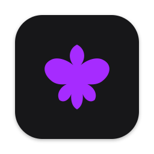
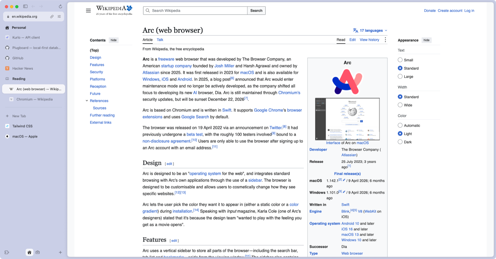
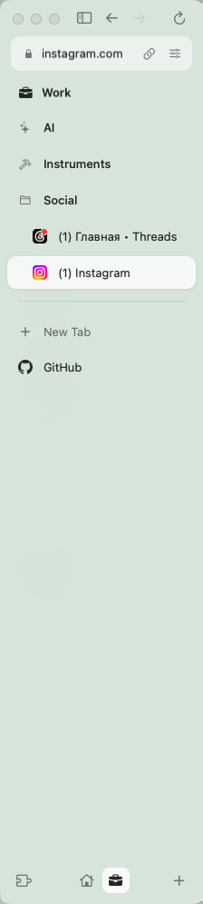
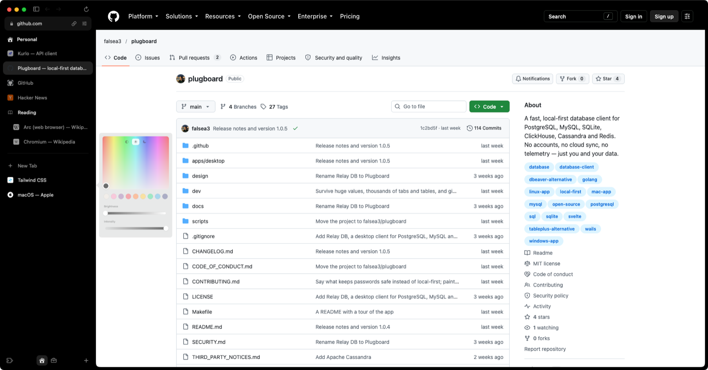
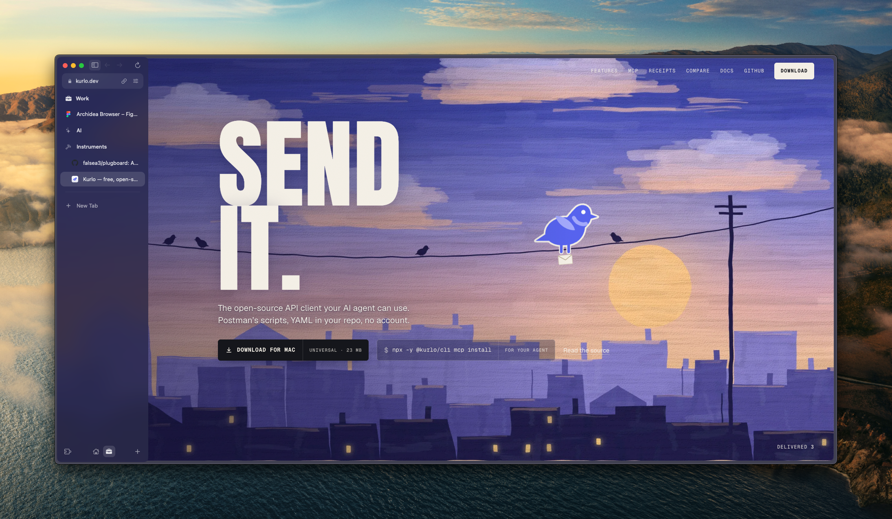
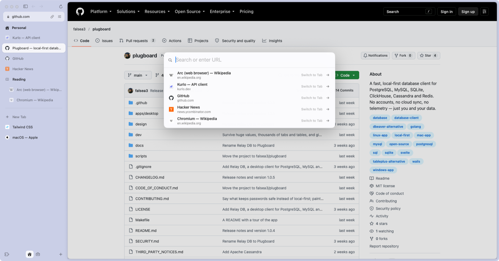
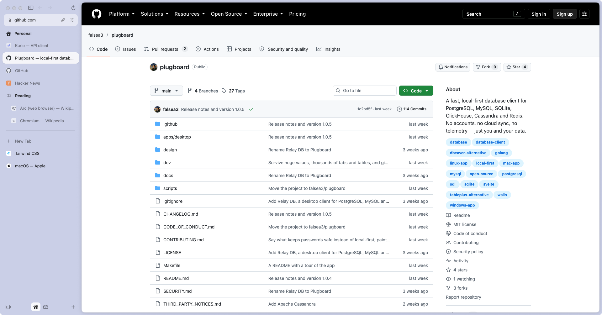
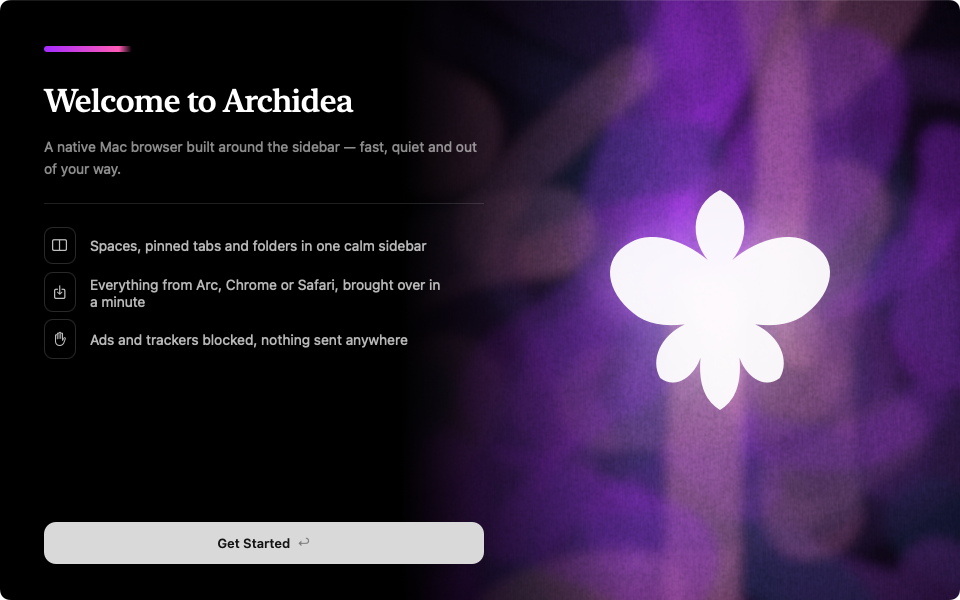

  

# Archidea

**A calm, fast browser for the Mac, built around the sidebar.**

Spaces, pinned tabs and folders — the ideas that made Arc feel like home, 
in a native Mac app that stays light.

<a href="https://github.com/getarchidea/archidea/releases/latest"><b>Download for macOS</b></a>
&nbsp;·&nbsp;
<a href="#-the-browser-is-the-sidebar">Features</a>
&nbsp;·&nbsp;
<a href="#-coming-from-arc">Coming from Arc</a>
&nbsp;·&nbsp;
<a href="#-faq">FAQ</a>

<picture>
  <source media="(prefers-color-scheme: dark)" srcset=".github/assets/hero-dark.png">
  
</picture>

The same window in a dark space: the page, the tint, the mood — all of it switches.

---

Arc showed that a browser can be organised like a workspace instead of a row of tabs. Arc is winding down, and the browsers that follow it grow heavier with every release. Archidea keeps the part that mattered — the sidebar — and builds it the way Mac apps should be built: **Swift and AppKit on top of Chromium, with nothing in between.**

- **Native, not a web app.** The window, the sidebar, the menus, the animations — all AppKit. Pages render with Chromium, so every site and every Chrome extension just works.
- **Light.** Tabs you haven't touched in a while quietly give their memory back; stale Today tabs tidy themselves away. Fifty pins don't mean fifty processes.
- **Private by default.** No account, no telemetry, no AI reading your pages. A built-in ad and tracker blocker is one switch away.

## 🗂 The browser is the sidebar

<table>
<tr>
<td width="260" valign="top">

</td>
<td valign="top">

**Spaces** with their own colour, icon and light or dark look — swipe between them with two fingers.

**Pinned tabs** that stay put, **folders** that nest, **Today tabs** that archive themselves after 12 hours — or never, your call.

Drag anything anywhere: between pins and Today, into folders, onto another space.

</td>
</tr>
</table>

Every space is a mood of its own — the colour, the tint strength, light or dark. Pages follow: a dark space asks sites for their dark look.

   
  Every space gets its own colour, tint strength and light or dark look.

When you need the whole screen, the sidebar slides away — and slides back over the page the moment your pointer touches the left edge, the way Arc did it.

   
  Hidden, but never more than a nudge away.

## ⌨️ ⌘T does everything

A command bar for addresses, searches, your open tabs and your history — one keystroke, type a few letters, Return.

   
  Addresses, searches, open tabs and history — one bar, one keystroke.

Site requests — location, camera, saving a password, opening an app — arrive as quiet cards in the corner of the page instead of dialogs that block the window. Site controls sit behind the address bar: permissions, zoom, extensions, clearing a site's data, its certificate.

## 🕶 Private windows

A private window keeps nothing: no history, no cookies, no sidebar left behind when it closes. Its dark look makes it easy to tell apart at a glance.

   
  Opens with ⇧⌘N. When it closes, it never happened.

## 🧳 Bring everything over

The welcome window finds your old browser — **Arc (spaces and pins included), Dia, Chrome, Safari, Firefox, Edge, Brave, Vivaldi, Opera and Helium** — and brings over bookmarks, history, passwords and sign-ins.

   
  First launch. Run it again any time from <b>File › Import from Another Browser…</b>

Chrome Web Store extensions work, including 1Password, Bitwarden, Proton Pass and KeePassXC. The built-in blocker (uBlock Origin) is one switch in the welcome window or in Settings.

## ⌨️ Keyboard

| | | | |
|---|---|---|---|
| New tab | <kbd>⌘</kbd><kbd>T</kbd> | Edit the address | <kbd>⌘</kbd><kbd>L</kbd> |
| Close tab | <kbd>⌘</kbd><kbd>W</kbd> | Reopen closed tab | <kbd>⇧</kbd><kbd>⌘</kbd><kbd>T</kbd> |
| Pin or unpin | <kbd>⌘</kbd><kbd>D</kbd> | Show / hide the sidebar | <kbd>⌘</kbd><kbd>S</kbd> |
| Next / previous space | <kbd>⌥</kbd><kbd>⌘</kbd><kbd>→</kbd> / <kbd>←</kbd> | New private window | <kbd>⇧</kbd><kbd>⌘</kbd><kbd>N</kbd> |
| New space | <kbd>⌃</kbd><kbd>⌘</kbd><kbd>N</kbd> | Find on page | <kbd>⌘</kbd><kbd>F</kbd> |
| Settings | <kbd>⌘</kbd><kbd>,</kbd> | | |

## 📦 Install

Download the **.dmg** from [Releases](https://github.com/getarchidea/archidea/releases/latest), drag **Archidea** into **Applications**, open it — it'll offer to bring over your tabs, bookmarks and passwords from whatever you're using now.

Requires macOS 14 Sonoma or later, on Apple silicon.

## 🌅 Coming from Arc

The welcome window finds Arc on your Mac and brings over your spaces with their pinned tabs and folders, plus bookmarks, history, passwords and sign-ins. A few things to know:

- Close Arc before importing sign-ins — Archidea offers to do it for you — so sessions come over fresh.
- Google and YouTube ask you to sign in once more: Google ends a session when its cookies move to another browser. Other sites stay signed in.
- Apple Passwords can't reach through its browser extension here (macOS only lets Apple's helper run under browsers Apple approves). Export from the Passwords app (**File › Export All Passwords**) and import the file instead.

## ❓ FAQ

<b>Is it free?</b>

Yes — free and open source under the GPL-3.0.

<b>Does it send anything anywhere?</b>

No telemetry and no accounts. It checks GitHub for new releases; otherwise the sites you visit see what any Chromium browser sends them.

<b>Where is my data?</b>

In `~/Library/Application Support/Archidea`, on your Mac. Nowhere else.

<b>Windows or Linux?</b>

Not yet — Archidea is a Mac app first.

<b>Is this Arc?</b>

No. Archidea is an independent project and isn't affiliated with The Browser Company. We just loved the same idea.

<b>How does it stay up to date?</b>

New versions download in the background, are verified with a release signature, and install when you quit — or right away from the sidebar. Debug builds never update themselves.

## ⭐ Star history

<a href="https://www.star-history.com/#getarchidea/archidea&Date">
  <picture>
    <source media="(prefers-color-scheme: dark)" srcset="https://api.star-history.com/svg?repos=getarchidea/archidea&type=Date&theme=dark">
    
  </picture>
</a>

---

Bug reports and ideas are welcome in [Issues](https://github.com/getarchidea/archidea/issues). To build Archidea yourself or send a change, see [CONTRIBUTING.md](CONTRIBUTING.md); security reports are described in [SECURITY.md](SECURITY.md).

Archidea is free software under the [GNU General Public License v3.0](LICENSE). It builds on Chromium and other open-source work; see [NOTICE](NOTICE.md).
