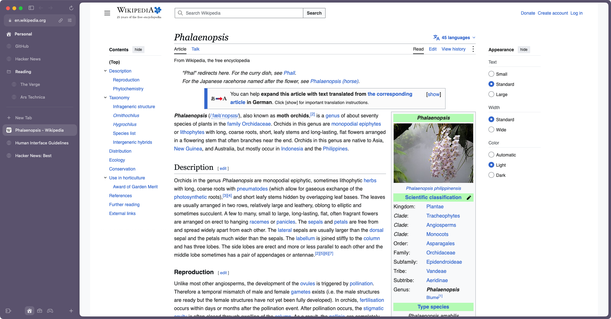

  

<h1 align="center">Archidea</h1>

  A calm, native browser for the Mac, built around the sidebar. 
  Spaces, pinned tabs and folders — inspired by Arc, without the weight.

  <a href="https://github.com/getarchidea/archidea/releases/latest"><b>Download for macOS</b></a>
  &nbsp;·&nbsp;
  <a href="#features">Features</a>
  &nbsp;·&nbsp;
  <a href="#coming-from-arc">Coming from Arc</a>
  &nbsp;·&nbsp;
  <a href="#faq">FAQ</a>

  

## Why Archidea

Arc showed that a browser can be organised like a workspace instead of a row of tabs. Arc is winding down, and
the browsers that follow it grow heavier every release. Archidea keeps the part that mattered — the sidebar — and
builds it the way Mac apps should be built: in Swift and AppKit, on top of Chromium, with nothing in between.

- **Native, not a web app.** The window, sidebar, menus and animations are AppKit. Pages render with Chromium, so
  every site and every Chrome extension works.
- **Light.** Background tabs give their memory back after a while; stale tabs tidy themselves away.
- **Private by default.** No account, no telemetry, no AI sending your pages anywhere. An ad and tracker blocker
  is built in, one switch away.

## Features

**Sidebar and spaces**
- Spaces with their own colour, icon and light or dark look — swipe between them with two fingers.
- Pinned tabs that stay put, folders that nest, Today tabs that archive themselves after 12 hours (or never).
- Drag anything anywhere: between pins and Today, into folders, onto another space.
- Hide the sidebar and it slides back in from the edge, Arc-style.

**Browsing**
- ⌘T opens a command bar for addresses, searches, open tabs and your history.
- Site controls in the address bar: permissions, zoom, extensions, clearing a site's data, its certificate.
- Private windows (⇧⌘N) that keep nothing: no history, no cookies, no sidebar left behind.
- Find on page, DevTools, picture-in-picture, downloads — Chromium's, untouched.
- Requests from sites — location, camera, saving a password — appear as quiet cards next to the page, not as
  alerts that block the window.

**Your data, your way**
- Import from Arc (spaces and pins included), Dia, Chrome, Safari, Firefox, Edge, Brave, Vivaldi, Opera and Helium:
  bookmarks, history, passwords and sign-ins.
- Chrome Web Store extensions, including 1Password, Bitwarden, Proton Pass and KeePassXC.
- Built-in ad and tracker blocking (uBlock Origin) — one switch in the welcome window or in Settings.
- English and Russian, following your Mac's language or your choice.

**Stays up to date**
- New versions download in the background and install when you quit — or right away from the sidebar.

## Install

1. Download the latest `Archidea-<version>.zip` from [Releases](https://github.com/getarchidea/archidea/releases/latest).
2. Unzip it and move **Archidea** to your Applications folder.
3. Open it. The welcome window brings your browser over and sets up the look you like.

Requires macOS 14 Sonoma or later on Apple silicon.

## Coming from Arc

The welcome window finds Arc on your Mac and brings over your spaces with their pinned tabs and folders, plus
bookmarks, history, passwords and sign-ins. You can run it again any time from **File › Import from Another
Browser…**.

A few things to know:
- Close Arc before importing sign-ins — Archidea offers to do it for you — so your sessions come over fresh.
- Google and YouTube ask you to sign in once more: Google ends a session when its cookies move to another
  browser. Other sites stay signed in.
- Apple Passwords can't be used through its browser extension in Archidea (macOS only lets Apple's helper run
  under browsers Apple approves). Export your passwords from the Passwords app (**File › Export All Passwords**)
  and import the file in **File › Import from Another Browser…**.

## Keyboard

| | |
|---|---|
| New tab | ⌘T |
| Edit the address | ⌘L |
| Show or hide the sidebar | ⌘S |
| Pin or unpin a tab | ⌘D |
| Next / previous space | ⌥⌘→ / ⌥⌘← |
| Reopen a closed tab | ⇧⌘T |
| New private window | ⇧⌘N |
| New space | ⌃⌘N |
| Find on page | ⌘F |
| Settings | ⌘, |

## FAQ

**Is it free?** Yes, and open source under the GPL-3.0.

**Does it send anything anywhere?** No telemetry and no accounts. It checks GitHub for new releases, and the
sites you visit see what any Chromium browser sends them.

**Where is my data?** In `~/Library/Application Support/Archidea` on your Mac.

**Windows or Linux?** Not yet. Archidea is a Mac app first.

**Is this Arc?** No. Archidea is an independent project, not affiliated with The Browser Company.

## Contributing

Bug reports and ideas are welcome in [Issues](https://github.com/getarchidea/archidea/issues). To build Archidea
yourself or send a change, see [CONTRIBUTING.md](CONTRIBUTING.md).

## License

Archidea is free software under the [GNU General Public License v3.0](LICENSE). It builds on Chromium and other
open-source work; see [NOTICE](NOTICE.md).
